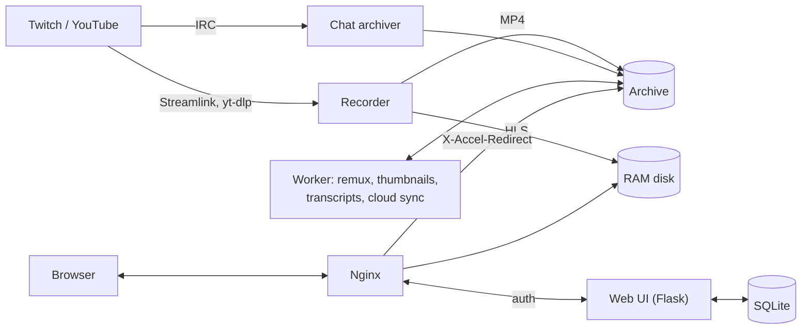

<div align="center">

# StreamVault

**Self-hosted recorder and archive for Twitch and YouTube live streams, with chat replay.**

[](https://github.com/Blackwellcode/streamvault/actions/workflows/ci.yml)
[](LICENSE)
[](pyproject.toml)

</div>

StreamVault watches the channels you choose, records every broadcast with
Streamlink and FFmpeg, archives the chat alongside it, and serves both through
a web interface where you can replay a stream with its chat, cut clips and
manage who may watch what. It runs on a single Linux server; video delivery is
handed to Nginx so the Python process stays small.

> The web interface is currently available in **German only**.

## Screenshots

| Dashboard | VOD player with chat replay |
| :---: | :---: |
|  |  |

| Channel archive | Users and groups |
| :---: | :---: |
|  |  |

| System status | Phone layout |
| :---: | :---: |
|  |  |

## Features

- **Automatic recording** of Twitch and YouTube channels (Streamlink, yt-dlp,
  FFmpeg), with reconnects, segment salvage and a disk-space guard that pauses
  new recordings before the disk fills up.
- **Chat archive and replay**: chat is stored next to each recording and
  replayed in sync with the video, including badges and emotes.
- **Live viewing** through a low-latency HLS restream from a RAM disk, so
  viewers watch through your server instead of the platform.
- **Clips**: cut lossless clips in the browser (keyframe-aligned `-c copy`).
- **Transcripts** with Whisper, run in a separate process.
- **Cloud archive**: offload recordings to S3-compatible storage (AWS, R2, B2,
  Wasabi, MinIO, Hetzner), Google Drive, Dropbox, OneDrive or WebDAV.
  Credentials are encrypted with AES-GCM; uploads and local deletion are off
  until you enable them.
- **Access control**: roles (Admin, Member, Viewer, Live-only), groups and
  per-channel allowlists, login rate limits and temporary IP bans.
- **OBS overlays** for chat, alert sounds and text-to-speech.
- **Efficient delivery**: Nginx serves video files via `X-Accel-Redirect`
  with byte ranges; SQLite in WAL mode, optional Redis cache.

## How it works



Three services run side by side: `recorder`, `worker` and `webui`.

## Installation

### Ubuntu 22.04+ / Debian 12+

```bash
git clone https://github.com/Blackwellcode/streamvault.git /tmp/streamvault
cd /tmp/streamvault && sudo ./install.sh
```

The installer sets up FFmpeg, Nginx and a Python environment, creates the
`streamvault` service user, registers the systemd services and prints a
generated admin password. Afterwards manage the installation with:

```bash
streamvault status         # services, health, RAM disk
streamvault logs all       # follow all service logs
streamvault restart        # restart services
streamvault update         # pull updates, upgrade dependencies, restart
streamvault config         # edit /etc/streamvault/env
```

Step-by-step manual installation and TLS setup: [INSTALL.md](INSTALL.md).

### Docker Compose

```bash
git clone https://github.com/Blackwellcode/streamvault.git
cd streamvault
cp .env.example .env
python3 -c "import secrets; print('VOD_PASS=' + secrets.token_urlsafe(24))"
python3 -c "import secrets; print('VOD_SECRET_KEY=' + secrets.token_hex(32))"
# put both values and VOD_USER into .env, then:
docker compose up -d --build
```

The UI is served on `http://localhost:8090`. Recordings, the database and
caches are stored in `./data`.

**Put StreamVault behind HTTPS before exposing it to the internet** and set
`VOD_SECURE_COOKIES=true` once it is.

## Configuration

All settings are environment variables (`/etc/streamvault/env`, or `.env` for
Docker). The most important ones:

| Variable | Default | Purpose |
| :--- | :--- | :--- |
| `VOD_USER`, `VOD_PASS` | *required* | Initial administrator account. |
| `VOD_SECRET_KEY` | *required* | Signs session cookies. Weak values are rejected. |
| `VOD_BASE_DIR` | `./data` if present, else the app directory | Archives, database and caches. |
| `VOD_PUBLIC_BASE` | *empty* | Public origin for share links and OAuth callbacks. |
| `VOD_SECURE_COOKIES` | `false` | Set to `true` once HTTPS is in place. |
| `VOD_TRUSTED_PROXIES` | `127.0.0.1,::1` | Proxies (IPs or CIDR) whose `X-Real-IP` is trusted for rate limits. |
| `LIVE_HLS_DIR` | `/dev/shm/streamvault_hls` | RAM disk for live HLS segments. |
| `VOD_USE_X_ACCEL` | `true` | Let Nginx serve video files. |
| `STORAGE_ENCRYPTION_KEY` | `VOD_SECRET_KEY` | Key for stored cloud credentials. Keep it stable. |
| `REDIS_URL` | *none* | Optional Redis cache. |

The full list with explanations is in [.env.example](.env.example).

## Cloud storage

Add providers in the web UI (**Systemsteuerung → Cloud-Speicher**) or on the
command line:

```bash
streamvault storage add --type s3 --name "R2" \
  --set bucket=streamvault --set access_key=... --set secret_key=... \
  --set endpoint_url=https://<account>.r2.cloudflarestorage.com
streamvault storage test 1
streamvault storage settings --set auto_upload=true
```

The local copy stays authoritative: files are only removed locally after a
successful upload and an optional size check, and only if you enable it. OAuth
providers (Google Drive, Dropbox, OneDrive) need the callback URL
`https://<your-host>/admin/storage/oauth/callback`.

## Legal notice

StreamVault is a tool for archiving streams you are allowed to archive, such
as your own channel or content whose rights holder agreed. Recording,
storing or redistributing other people's streams can violate copyright and the
platforms' terms of service. You are responsible for how you use it.

## Contributing

Bug reports, fixes and improvements are welcome. Read
[CONTRIBUTING.md](CONTRIBUTING.md) first; security issues go through
[SECURITY.md](SECURITY.md). Changes are listed in [CHANGELOG.md](CHANGELOG.md).

## License

[MIT](LICENSE)
