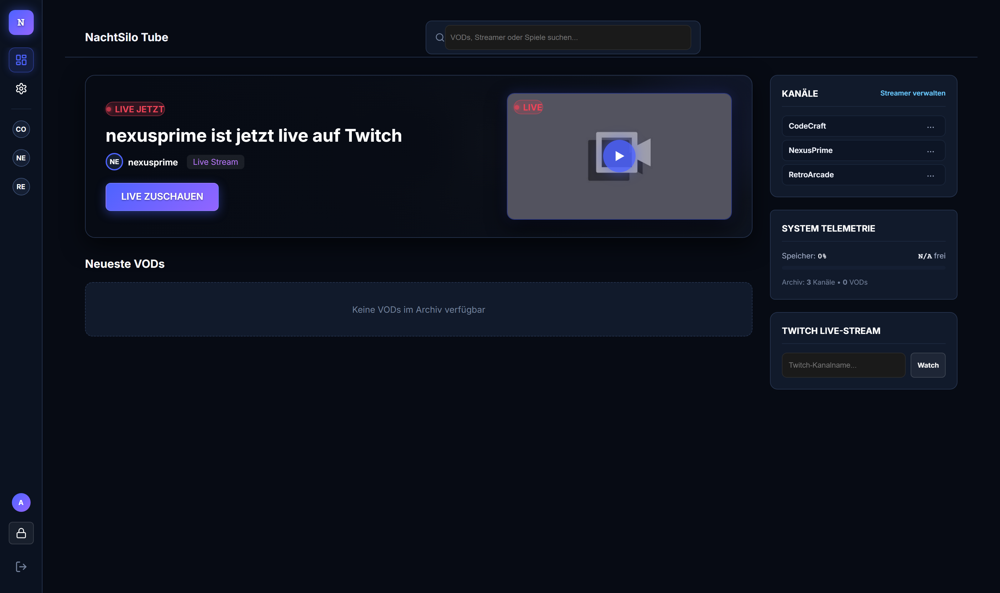
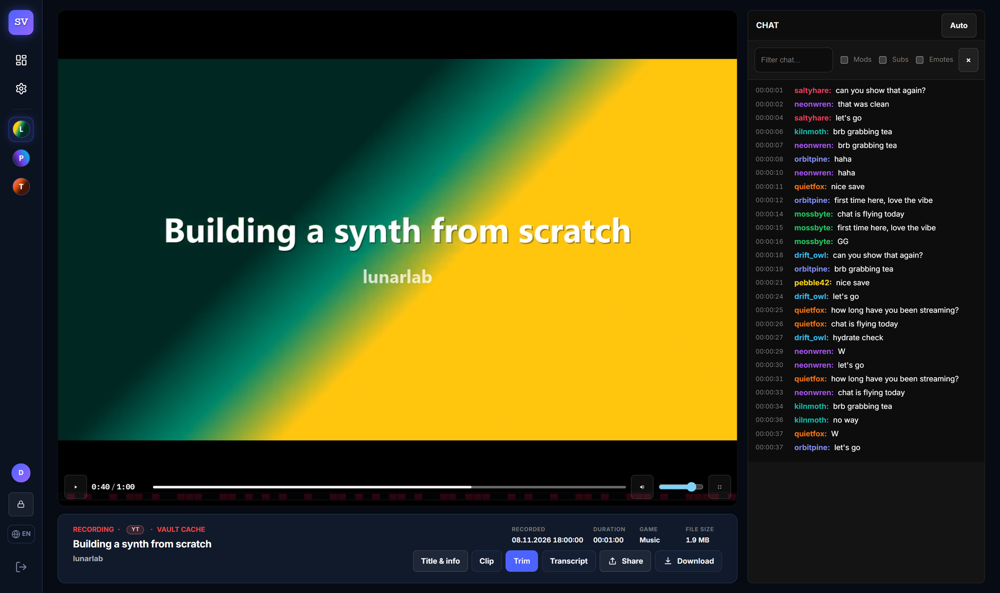
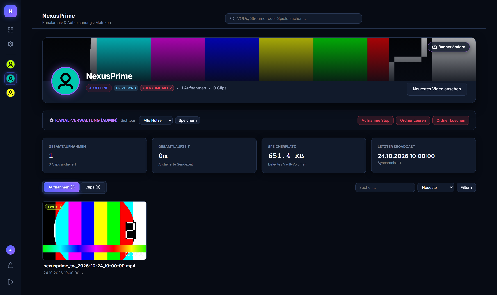
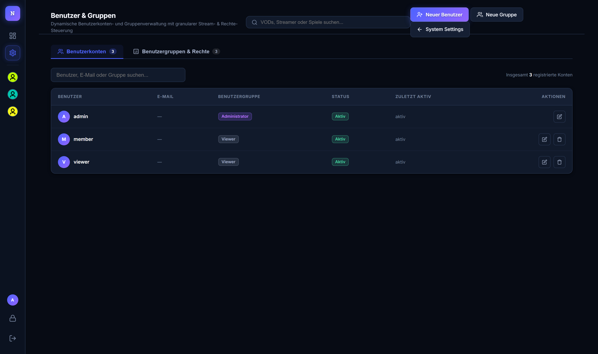
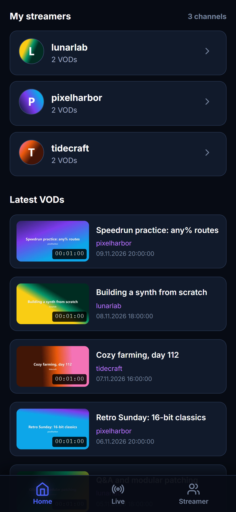
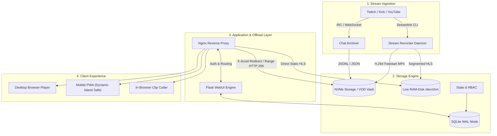

<div align="center">

# StreamVault
### High-Performance Self-Hosted Stream Archiver, Live Proxy & Interactive VOD Vault

[](https://www.python.org/)
[](https://flask.palletsprojects.com/)
[](https://nginx.org/)
[](https://www.sqlite.org/)
[](https://www.docker.com/)
[](LICENSE)

*A privacy-first, enterprise-grade streaming infrastructure for creator collectives, esports teams, and media archives.*

</div>

---

## 🌟 Overview

**StreamVault** is a modular, high-efficiency streaming platform engineered to capture, archive, and replay live streams alongside synchronized chat timelines. Designed to operate on low-cost VPS instances or dedicated bare-metal servers, it combines kernel-level Nginx offloading, SQLite concurrency in WAL mode, and sub-second live HLS transmuxing.

This open-core edition is **100% sanitized**: free of private streamer configurations, tracking tools, hardcoded tokens, or proprietary credentials.

---

## 📸 Interface Showcase

| Live Dashboard & Telemetry | VOD Player with Chat Replay |
| :---: | :---: |
|  |  |

| Streamer Channel Vault | RBAC User & Group Management |
| :---: | :---: |
|  |  |

| System Health & Metrics | Mobile Responsive PWA Layout |
| :---: | :---: |
|  |  |

---

## ⚡ Core Capabilities

- **Automated 24/7 Stream Recording**: Background worker daemons monitor target channels (Twitch, Kick, YouTube) and capture broadcasts via `streamlink` and `ffmpeg` with automatic stream reconnect and segmented salvage.
- **Synchronized Chat Replay**: Archives live chat messages in real time (`.chat.json`), aligning badges, emotes, and timestamps exactly with video scrubbing.
- **Kernel-Level Media Offloading**: Integrates with Nginx via `X-Accel-Redirect` (HTTP 206 Partial Content / Range Requests). Python workers release memory immediately while the Linux kernel streams gigabyte-scale MP4 files directly to viewers.
- **Live RAM-Disk Transmuxing**: Low-latency HLS restreaming (`/dev/shm`) allows authenticated viewers to watch private live streams without exposing individual client IPs.
- **Lossless In-Browser Clip Cutter**: Web-based timeline selector exports shareable MP4 clips in seconds via keyframe-aligned FFmpeg slicing (`-c copy`).
- **Provider-Agnostic Cloud Archive**: Offload VODs to Google Drive, S3-compatible storage (AWS, R2, B2, Wasabi, MinIO, Hetzner), Dropbox, OneDrive or WebDAV. Configure and test providers in the WebUI (`Systemsteuerung → Cloud-Speicher`) or with `streamvault storage`; credentials are encrypted with AES-GCM.
- **Granular RBAC Security**: Multi-tier permissions (`Admin`, `Viewer`, `Member`, `Live-only`) with channel-specific allowlists and brute-force protection.

---

## 🏗️ Architecture & Pipeline



---

## ⚡ 1-Command Linux Installation & System Registration

For production installations on Ubuntu 22.04+ or Debian 12+, run the automated installer:

```bash
# Clone and run the turnkey installer:
git clone https://github.com/Blackwellcode/streamvault.git /tmp/streamvault
cd /tmp/streamvault && sudo ./install.sh
```

The installer automatically:
1. Installs all system dependencies (`ffmpeg`, `python3-venv`, `nginx`, `sqlite3`).
2. Configures the isolated service user and directories (`/opt/streamvault`, `/var/lib/streamvault`).
3. Registers systemd services (`streamvault-webui.service`, `streamvault-recorder.service`, `streamvault-worker.service`).
4. Configures Nginx with `X-Accel-Redirect` kernel video offload.
5. **Registers the global Linux management command** `/usr/local/bin/streamvault`:

```bash
# Manage your installation from anywhere:
streamvault status       # Check daemons, health, and RAM-disk
streamvault logs all     # Follow live daemon logs
streamvault restart      # Restart services
streamvault update       # Pull Git updates, upgrade deps, and restart
streamvault config       # Edit /etc/streamvault/env
streamvault check        # Validate Python syntax & Nginx integrity
```

---

## 🐳 Docker Deployment

To run StreamVault in production via Docker Compose:

```bash
# 1. Clone repository
git clone https://github.com/Blackwellcode/streamvault.git
cd streamvault

# 2. Copy environment template
cp .env.example .env

# 3. Set your production secrets in .env
#    Generate values with:
python -c "import secrets; print('VOD_PASS=' + secrets.token_urlsafe(24))"
python -c "import secrets; print('VOD_SECRET_KEY=' + secrets.token_hex(32))"
nano .env

# 4. Build and run
docker compose up -d --build
```

Access the service at `http://localhost:8090`.

The Compose stack runs the WebUI, recorder and background worker under
supervisord and shares the `hls_live` volume with the Nginx container. The
application directory is bind-mounted at `/app`; recordings, the database and
caches live in `./data` (`VOD_BASE_DIR=/app/data`). Set `VOD_PUBLIC_BASE` in `.env` to the public URL used
by browsers (for example `https://recorder.example.com`) so OAuth callbacks and
share links are generated correctly.

For detailed step-by-step production instructions (including bare-metal Ubuntu/Debian deployment, systemd daemons, and SSL setup), see [INSTALL.md](INSTALL.md).

---

## ☁️ Cloud / External Storage

StreamVault can archive VOD files to external storage without changing playback:
the local archive stays authoritative, uploads run in the background worker, and
local files are only removed after a successful upload and an optional remote
size check.

Supported providers:

| Provider | Configuration |
| :--- | :--- |
| **Google Drive** | OAuth Client ID/Secret, then "Mit Google verbinden" in the WebUI |
| **S3-compatible** | Bucket, access key, secret, region, optional endpoint (AWS, R2, B2, Wasabi, MinIO, Hetzner) |
| **Dropbox** | App Key/Secret, then OAuth connection |
| **OneDrive / Microsoft 365** | Client ID/Secret + tenant, then OAuth connection |
| **WebDAV** | Base URL, username, app password (Nextcloud, ownCloud, Hetzner Storage Box) |

Open **Systemsteuerung → Cloud-Speicher** (`/admin/storage`) to add providers,
test connections, choose the default target, and configure automation. The
same operations are available from the console:

```bash
streamvault storage types
streamvault storage add --type google_drive --name "Drive Archive"
streamvault storage add --type s3 --name "R2" \
  --set bucket=streamvault --set access_key=... --set secret_key=... \
  --set endpoint_url=https://<account>.r2.cloudflarestorage.com
streamvault storage test 1
streamvault storage sync
streamvault storage upload /var/lib/streamvault/data/mychannel/video.mp4
streamvault storage objects
streamvault storage restore 42
streamvault storage settings --set auto_upload=true
```

OAuth providers require this callback URL to be registered with the provider:

```
https://<your-public-host>/admin/storage/oauth/callback
```

Set `VOD_PUBLIC_BASE` to the exact public HTTPS origin if it differs from the
request host. Credentials are encrypted at rest with AES-GCM using
`STORAGE_ENCRYPTION_KEY` (or `VOD_SECRET_KEY` as a fallback). Keep that key
stable and backed up; changing it makes stored credentials unreadable.

Safety defaults: automatic upload is **off**, deletion of local copies is
**off**, and the local retention period is **14 days**. Enable these settings
deliberately in the WebUI or with `streamvault storage settings`.

---

## ⚙️ Configuration Reference

Key variables configurable via `.env`:

| Variable | Default | Purpose |
| :--- | :--- | :--- |
| `VOD_HOST` | `0.0.0.0` | Bind IP for the Python WebUI. |
| `VOD_PORT` | `8080` | Bind port for the Python WebUI. |
| `VOD_USER` | *required* | Initial administrator username (production). |
| `VOD_PASS` | *required* | Initial administrator password (production). |
| `VOD_SECRET_KEY` | *required* | Secret key for signed session cookies. |
| `VOD_BASE_DIR` | `./data` | Root path for databases and video storage. |
| `VOD_PUBLIC_BASE` | *empty* | Public origin for share links and OAuth callbacks. Empty = derive from request. |
| `LIVE_HLS_DIR` | `/dev/shm/...` | High-speed RAM-disk path for live streaming. |
| `VOD_USE_X_ACCEL` | `true` | Enables Nginx `X-Accel-Redirect` byte-range streaming. |
| `STORAGE_ENCRYPTION_KEY` | *fallback* | Dedicated AES-GCM key for cloud credentials; falls back to `VOD_SECRET_KEY`. |
| `WORKER_STORAGE_THREADS` | `1` | Parallel upload/restore workers in the background task worker. |
| `REDIS_URL` | *none* | Optional Redis connection string for caching. |

---

## 🔒 Security & Privacy Invariants

1. **Zero Secret Leakage**: No API tokens, passwords, or OAuth tokens are ever logged, passed via CLI flags visible in `ps aux`, or stored in source control.
2. **Subprocess Isolation**: All FFmpeg and Streamlink subroutines execute with `shell=False` and strict execution timeouts.
3. **Process Safety**: Daemon termination utilizes process-group validation preventing self-kill or supervisor collisions.
4. **Range Request Protection**: Offloading to Nginx ensures memory exhaustion attacks via concurrent scrubbing cannot starve web application threads.

---

## 📄 License

This project is licensed under the [MIT License](LICENSE).
