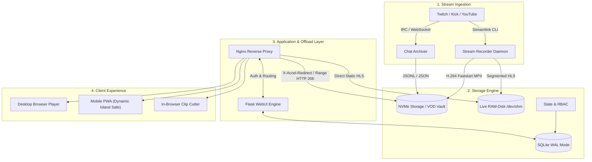

<div align="center">

# NachtSilo Hub (StreamVault Core)
### High-Performance Self-Hosted Stream Archiver, Live Proxy & Interactive VOD Vault

[](https://www.python.org/)
[](https://flask.palletsprojects.com/)
[](https://nginx.org/)
[](https://www.sqlite.org/)
[](https://www.docker.com/)
[](LICENSE)

*A privacy-first, enterprise-grade streaming infrastructure for creator collectives, esports teams, and media archives.*

</div>

---

## 🌟 Overview

**NachtSilo Hub** is a modular, high-efficiency streaming platform engineered to capture, archive, and replay live streams alongside synchronized chat timelines. Designed to operate on low-cost VPS instances or dedicated bare-metal servers, it combines kernel-level Nginx offloading, SQLite concurrency in WAL mode, and sub-second live HLS transmuxing.

This open-core edition is **100% sanitized**: free of private streamer configurations, tracking tools, hardcoded tokens, or proprietary credentials. It includes a turnkey **Demo Mode** to evaluate all capabilities instantly.

---

## 📸 Interface Showcase

| Live Dashboard & Telemetry | VOD Player with Chat Replay |
| :---: | :---: |
|  |  |

| Streamer Channel Vault | RBAC User & Group Management |
| :---: | :---: |
|  |  |

| System Health & Metrics | Mobile Responsive PWA Layout |
| :---: | :---: |
|  |  |

---

## ⚡ Core Capabilities

- **Automated 24/7 Stream Recording**: Background worker daemons monitor target channels (Twitch, Kick, YouTube) and capture broadcasts via `streamlink` and `ffmpeg` with automatic stream reconnect and segmented salvage.
- **Synchronized Chat Replay**: Archives live chat messages in real time (`.chat.json`), aligning badges, emotes, and timestamps exactly with video scrubbing.
- **Kernel-Level Media Offloading**: Integrates with Nginx via `X-Accel-Redirect` (HTTP 206 Partial Content / Range Requests). Python workers release memory immediately while the Linux kernel streams gigabyte-scale MP4 files directly to viewers.
- **Live RAM-Disk Transmuxing**: Low-latency HLS restreaming (`/dev/shm`) allows authenticated viewers to watch private live streams without exposing individual client IPs.
- **Lossless In-Browser Clip Cutter**: Web-based timeline selector exports shareable MP4 clips in seconds via keyframe-aligned FFmpeg slicing (`-c copy`).
- **Granular RBAC Security**: Multi-tier permissions (`Admin`, `Viewer`, `Member`, `Live-only`) with channel-specific allowlists and brute-force protection.
- **Turnkey Demo Mode**: Built-in mock dataset generator seeds neutral streamers, playable test media, and 14 days of telemetry with a single command.

---

## 🏗️ Architecture & Pipeline



---

## ⚡ 1-Command Linux Installation & System Registration

For production installations on Ubuntu 22.04+ or Debian 12+, run the automated installer:

```bash
# Clone and run the turnkey installer:
git clone https://github.com/Blackwellcode/nachtsilo-hub.git /tmp/nachtsilo
cd /tmp/nachtsilo && sudo ./install.sh
```

The installer automatically:
1. Installs all system dependencies (`ffmpeg`, `python3-venv`, `nginx`, `sqlite3`).
2. Configures the isolated service user and directories (`/opt/nachtsilo`, `/var/lib/nachtsilo`).
3. Registers systemd services (`nachtsilo-webui.service`, `nachtsilo-recorder.service`).
4. Configures Nginx with `X-Accel-Redirect` kernel video offload.
5. **Registers the global Linux management command** `/usr/local/bin/nachtsilo`:

```bash
# Manage your installation from anywhere:
nachtsilo status       # Check daemons, health, and RAM-disk
nachtsilo logs all     # Follow live daemon logs
nachtsilo restart      # Restart services
nachtsilo demo         # Launch standalone demo mode
nachtsilo update       # Pull Git updates, upgrade deps, and restart
nachtsilo config       # Edit /etc/nachtsilo/env
nachtsilo check        # Validate Python syntax & Nginx integrity
```

---

## 🚀 Quickstart (Demo Mode in 60 Seconds)

You can launch the full application locally with zero configuration or external API keys:

### 1. Prerequisites
- Python 3.11+
- FFmpeg (for video generation and thumbnail extraction)

### 2. Setup & Launch
```bash
# Clone the repository
git clone https://github.com/Blackwellcode/nachtsilo-hub.git
cd nachtsilo-hub

# Create virtual environment
python -m venv .venv

# Activate environment
# On Linux/macOS:
source .venv/bin/activate
# On Windows:
.venv\Scripts\activate

# Install dependencies
pip install -r requirements.txt

# Start in Demo Mode
python WEBUI/webui.py --demo --port 8080
```

### 3. Access Local Demo
> [!NOTE]
> `http://localhost:8080` is a local loopback address. It is only accessible in your browser **after** you have cloned the repository and started the server locally on your machine.

Once the command above is running, open your browser at `http://localhost:8080/login`:
- **Username**: `admin`
- **Password**: `admin`

*The demo environment automatically populates realistic mock streamers (`NexusPrime`, `CodeCraft`, `RetroArcade`), playable video archives, chat timelines, and system traffic.*

---

## 🐳 Docker Deployment

To run NachtSilo Hub in production via Docker Compose:

```bash
# 1. Copy environment template
cp .env.example .env

# 2. Set your production secrets in .env
nano .env

# 3. Build and run
docker compose up -d --build
```

Access the service at `http://localhost:8090`.

For detailed step-by-step production instructions (including bare-metal Ubuntu/Debian deployment, systemd daemons, and SSL setup), see [INSTALL.md](INSTALL.md).

---

## ⚙️ Configuration Reference

Key variables configurable via `.env`:

| Variable | Default | Purpose |
| :--- | :--- | :--- |
| `VOD_HOST` | `0.0.0.0` | Bind IP for the Python WebUI. |
| `VOD_PORT` | `8080` | Bind port for the Python WebUI. |
| `VOD_USER` | *required* | Initial administrator username (production). |
| `VOD_PASS` | *required* | Initial administrator password (production). |
| `VOD_SECRET_KEY` | *required* | Secret key for signed session cookies. |
| `DEMO_MODE` | `false` | Enables sandbox demo mode with mock data. |
| `VOD_BASE_DIR` | `./data` | Root path for databases and video storage. |
| `LIVE_HLS_DIR` | `/dev/shm/...` | High-speed RAM-disk path for live streaming. |
| `VOD_USE_X_ACCEL` | `true` | Enables Nginx `X-Accel-Redirect` byte-range streaming. |
| `REDIS_URL` | *none* | Optional Redis connection string for caching. |

---

## 🔒 Security & Privacy Invariants

1. **Zero Secret Leakage**: No API tokens, passwords, or OAuth tokens are ever logged, passed via CLI flags visible in `ps aux`, or stored in source control.
2. **Subprocess Isolation**: All FFmpeg and Streamlink subroutines execute with `shell=False` and strict execution timeouts.
3. **Process Safety**: Daemon termination utilizes process-group validation preventing self-kill or supervisor collisions.
4. **Range Request Protection**: Offloading to Nginx ensures memory exhaustion attacks via concurrent scrubbing cannot starve web application threads.

---

## 📄 License

This project is licensed under the [MIT License](LICENSE).
