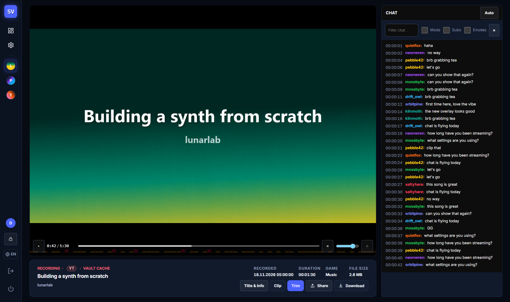
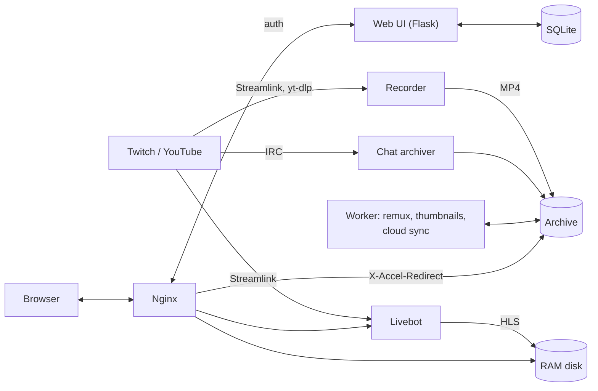
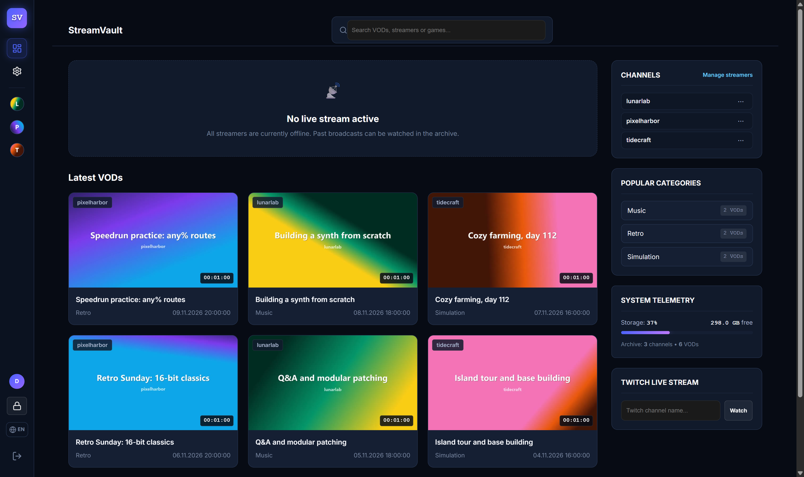
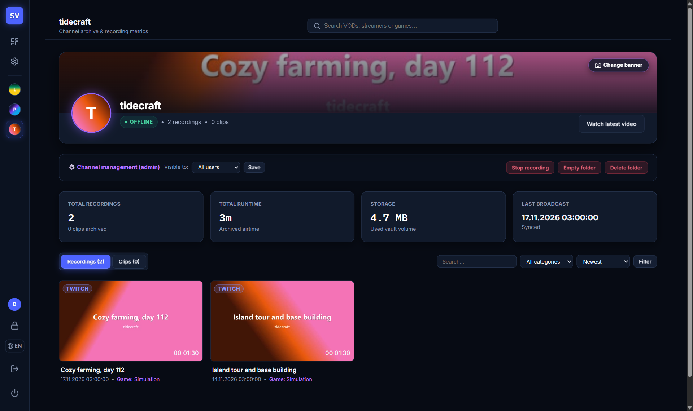
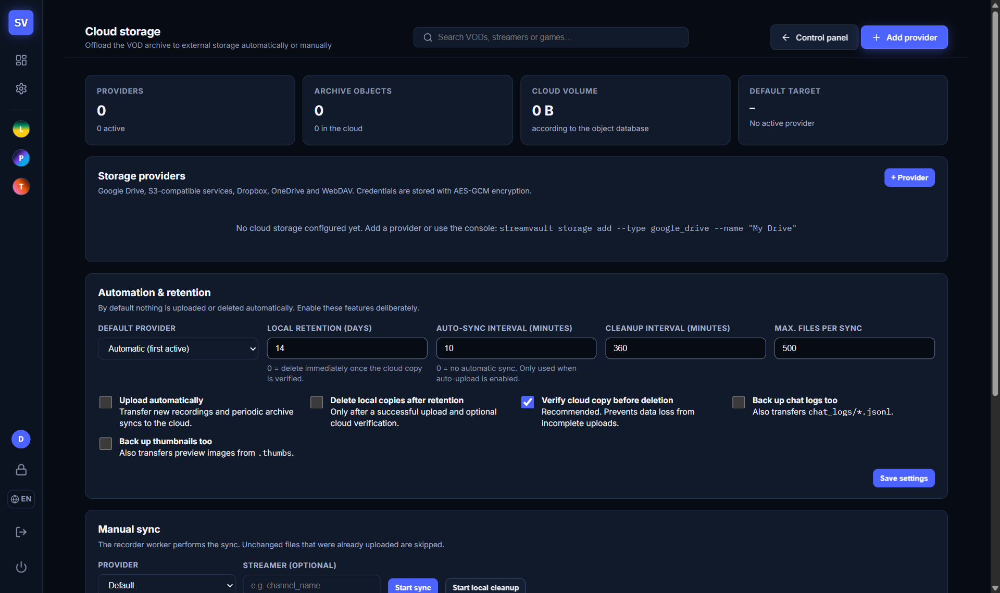
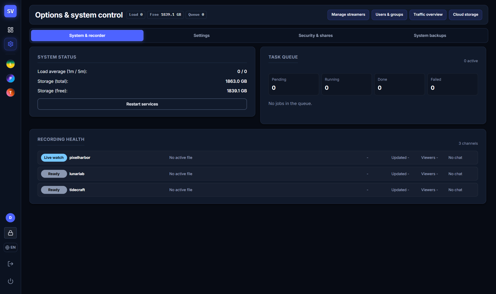
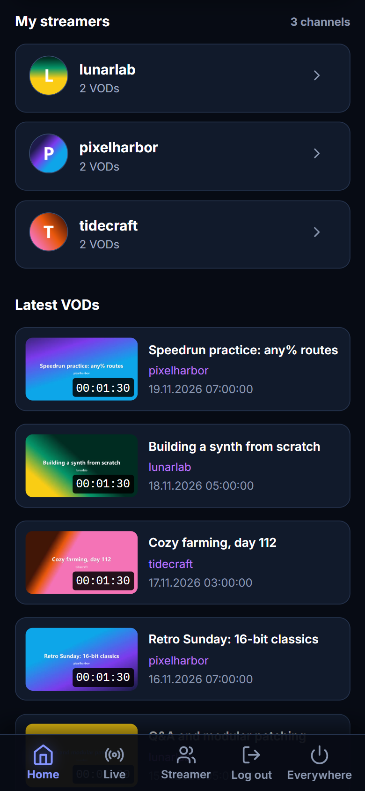

<div align="center">

# StreamVault

**Self-hosted recorder and archive for Twitch and YouTube live streams, with chat replay.**

[](https://github.com/Blackwellcode/streamvault/actions/workflows/ci.yml)
[](LICENSE)
[](pyproject.toml)
[](https://buymeacoffee.com/blackwellcode)



</div>

StreamVault watches the channels you choose, records every broadcast with
Streamlink and FFmpeg, archives the chat alongside it, and serves both through
a web interface where you can replay a stream with its chat, cut clips and
manage who may watch what. It runs on a single Linux server; video delivery is
handed to Nginx so the Python process stays small.

## Quick start

### Try the demo locally

You can look around without recording anything. `scripts/demo_seed.py`
renders a few short sample recordings with chat (FFmpeg test sources, no
third-party content) into an empty directory:

```bash
git clone https://github.com/Blackwellcode/streamvault.git && cd streamvault
python3 -m venv .venv && . .venv/bin/activate
pip install -r requirements.txt
python scripts/demo_seed.py --base-dir ./demo-data
VOD_BASE_DIR=./demo-data VOD_USE_X_ACCEL=false \
VOD_USER=demo VOD_PASS='choose-a-password' \
VOD_SECRET_KEY="$(python3 -c 'import secrets; print(secrets.token_hex(32))')" \
python -m WEBUI.webui --host 127.0.0.1 --port 8080
```

Requires FFmpeg on the `PATH`. Open `http://127.0.0.1:8080` and sign in with
the `VOD_USER` and `VOD_PASS` values from the command.

### Install on a server (Ubuntu 22.04+ / Debian 12+)

```bash
git clone https://github.com/Blackwellcode/streamvault.git /tmp/streamvault
cd /tmp/streamvault && sudo ./install.sh
```

The installer sets up FFmpeg, Nginx and a Python environment, creates the
`streamvault` service user, registers the systemd services and generates an
admin password (user `vaultadmin`; read it with
`sudo grep '^VOD_PASS=' /etc/streamvault/env`). Afterwards manage the
installation with:

```bash
streamvault status         # services, health, RAM disk
streamvault logs all       # follow all service logs
streamvault restart        # restart services
streamvault update         # pull updates, upgrade dependencies, restart
streamvault config         # edit /etc/streamvault/env
```

### Docker Compose

```bash
git clone https://github.com/Blackwellcode/streamvault.git
cd streamvault
cp .env.example .env
python3 -c "import secrets; print('VOD_PASS=' + secrets.token_urlsafe(24))"
python3 -c "import secrets; print('VOD_SECRET_KEY=' + secrets.token_hex(32))"
# put both values and VOD_USER (not "admin") into .env, then:
docker compose up -d --build
```

The UI is served on `http://localhost:8090`. Recordings, the database and
caches are stored in `./data`.

Manual installation, systemd units, the Nginx site and TLS:
[INSTALL.md](INSTALL.md). **Put StreamVault behind HTTPS before exposing it to
the internet** and set `VOD_SECURE_COOKIES=true` once it is.

## Features

### Recording

- Automatic recording of Twitch and YouTube channels (Streamlink, yt-dlp,
  FFmpeg), with reconnects, segment salvage and a disk-space guard that pauses
  new recordings before the disk fills up.
- Chat is archived next to each recording.
- `streamvault stop|restart|update` refuse to interrupt running recordings
  unless you pass `--force`.

### Watching

- VOD player with chat replay in sync with the video, including badges and
  emotes.
- Live viewing through your server: the `livebot` service fetches a Twitch
  stream once while someone watches and serves it as real-time MPEG-TS with an
  HLS fallback from a RAM disk. Streamlink filters Twitch ad segments, so
  viewers get no player ads; during an ad break the picture can pause. The
  Twitch player embed is optional (`LIVE_TWITCH_EMBED`) and off by default.
- Lossless clips cut in the browser (keyframe-aligned `-c copy`).
- OBS overlays for chat and alert sounds.

### Archive and storage

- Cloud archive: offload recordings to S3-compatible storage (AWS, R2, B2,
  Wasabi, MinIO, Hetzner), Google Drive, Dropbox, OneDrive or WebDAV.
  Credentials are encrypted with AES-GCM; uploads and local deletion are off
  until you enable them.
- `scripts/vod_retention.py` deletes local VODs older than N days (dry run
  unless `--enforce`). Channels that another job copies elsewhere are only
  deleted once they are listed in an offload manifest. See
  [INSTALL.md](INSTALL.md), "VOD retention".

### Access and privacy

- Roles (Admin, Member, Viewer, Live-only), groups and per-channel
  allowlists, login rate limits and temporary IP bans.
- Sessions expire after 30 days by default; "log out everywhere" and every
  password change sign the account out on all devices.
- Direct live routes (MPEG-TS stream, LL-HLS playlist and segments) are only
  served after Nginx `auth_request` confirms the session and the channel's
  visibility.
- Self-hosted fonts and access logs without query strings; see
  [Privacy by default](#privacy-by-default).

### Operations

- Nginx serves video files via `X-Accel-Redirect` with byte ranges; SQLite in
  WAL mode, optional Redis cache.
- `/metrics` for admins or a `METRICS_TOKEN`; optional error reporting with
  `sentry-sdk` (`pip install "sentry-sdk[flask]"`, `SENTRY_DSN=...`).

## How it works



Four services run side by side: `recorder`, `worker`, `livebot` and `webui`.

## Screenshots

| Dashboard | Channel archive |
| :---: | :---: |
|  |  |

| Cloud storage | System status |
| :---: | :---: |
|  |  |

| Phone layout |
| :---: |
|  |

## Privacy by default

- **No third-party fonts.** Inter and IBM Plex Mono are served by StreamVault
  itself; browsers make no request to Google Fonts.
- **No Twitch embed by default.** Every device plays the server stream, so the
  Twitch player never runs in the viewer's browser and the video comes from
  your server. `LIVE_TWITCH_EMBED=true` brings the embed back.
- **Tokens stay out of logs.** The Nginx and gunicorn access logs record the
  path without the query string, and overlay tokens go in the URL fragment
  (`#token=`), which browsers never send to the server.
- **Exceptions.** The chat view loads emote lists and images from 7TV,
  BetterTTV, FrankerFaceZ, ivr.fi and the Twitch CDN, the live overview loads
  preview images from the Twitch CDN, and the live player and the clip editor
  load scripts from jsDelivr and cdnjs. Viewers' browsers contact those hosts.

## Upgrading from 0.1

Release 0.2 changes minimum dependency versions, session lifetime, overlay token
handling, Docker user IDs and the Nginx site (new `/_live_auth` and direct live
locations), adds the `livebot` service, and removes Whisper transcription and
the text-to-speech overlay. Installations made with `install.sh` are updated by
running `sudo ./install.sh` from a fresh clone. Read the breaking changes in
[CHANGELOG.md](CHANGELOG.md) before you update.

## Requirements

- Linux server (Ubuntu 22.04+ or Debian 12+ for the installer), or Docker.
- Python 3.10+, FFmpeg, Nginx; Redis is optional.
- Sizing and versions: [INSTALL.md](INSTALL.md), section 1.

## Configuration

All settings are environment variables (`/etc/streamvault/env`, or `.env` for
Docker). The most important ones:

| Variable | Default | Purpose |
| :--- | :--- | :--- |
| `VOD_USER`, `VOD_PASS` | *required* | Initial administrator account. |
| `VOD_SECRET_KEY` | *required* | Signs session cookies. Weak values are rejected. |
| `VOD_BASE_DIR` | `./data` if present, else the app directory | Archives, database and caches. |
| `VOD_PUBLIC_BASE` | *empty* | Public origin for share links and OAuth callbacks. |
| `VOD_SECURE_COOKIES` | `false` | Set to `true` once HTTPS is in place. |
| `VOD_TRUSTED_PROXIES` | `127.0.0.1,::1` | Proxies (IPs or CIDR) whose `X-Real-IP` is trusted for rate limits. |
| `LIVE_HLS_DIR` | `/dev/shm/streamvault_hls` | RAM disk for live HLS segments. |
| `LIVE_TWITCH_EMBED` | `false` | Twitch player embed on the live page. Off: server stream only (no Twitch ads, viewer IPs stay private). |
| `VOD_USE_X_ACCEL` | `true` | Let Nginx serve video files. |
| `STORAGE_ENCRYPTION_KEY` | `VOD_SECRET_KEY` | Key for stored cloud credentials. Keep it stable. |
| `REDIS_URL` | *none* | Optional Redis cache. |

The full list with explanations is in [.env.example](.env.example).

### Cloud storage

Add providers in the web UI (**Options → Cloud storage**) or on the
command line:

```bash
streamvault storage add --type s3 --name "R2" \
  --set bucket=streamvault --set access_key=... --set secret_key=... \
  --set endpoint_url=https://<account>.r2.cloudflarestorage.com
streamvault storage test 1
streamvault storage settings --set auto_upload=true
```

The local copy stays authoritative: files are only removed locally after a
successful upload and an optional size check, and only if you enable it. OAuth
providers (Google Drive, Dropbox, OneDrive) need the callback URL
`https://<your-host>/admin/storage/oauth/callback`.

## Languages

English, Deutsch, Français, Español, Italiano, Português (Brasil), Nederlands,
Polski, Türkçe, 日本語, 简体中文 and 한국어. The interface follows the browser
language and can be switched on the login page and in the sidebar.
Translations other than English and German were produced without
native-speaker review; corrections are very welcome (see
[CONTRIBUTING.md](CONTRIBUTING.md#translations)).

## Legal notice

StreamVault is a tool for archiving streams you are allowed to archive, such
as your own channel or content whose rights holder agreed. Recording,
storing or redistributing other people's streams can violate copyright and the
platforms' terms of service. You are responsible for how you use it.

## Contributing

Bug reports, fixes and improvements are welcome. Read
[CONTRIBUTING.md](CONTRIBUTING.md) first. Changes are listed in
[CHANGELOG.md](CHANGELOG.md).

The test suite uses the standard library runner; ruff is the only extra tool
(development only, the version CI uses):

```bash
python -m unittest discover -s tests -p "test_*.py"
pip install ruff==0.17.3 && ruff check .
```

Tests that need POSIX process groups, `flock` or symlinks skip themselves on
Windows and run in CI on Linux.

## Security

Report security issues privately as described in [SECURITY.md](SECURITY.md),
not in public issues.

## Support the project

StreamVault is free and developed in spare time. If it is useful to you, you
can support further development:

<a href="https://buymeacoffee.com/blackwellcode"></a>

## License

[MIT](LICENSE)

The bundled UI fonts Inter and IBM Plex Mono (`WEBUI/static/fonts/`) are
licensed under the SIL Open Font License 1.1; see
[LICENSE-Inter.txt](WEBUI/static/fonts/LICENSE-Inter.txt) and
[LICENSE-IBM-Plex-Mono.txt](WEBUI/static/fonts/LICENSE-IBM-Plex-Mono.txt).
They are served by StreamVault itself; browsers make no request to Google
Fonts.
